<div align="center">

# Tiviate

**A fast, modern live-TV player for Android TV and Fire TV — for your own IPTV subscription.**

M3U links · Xtream Codes · local M3U files · full TV guide · 40 languages · every feature free

[](LICENSE)


[Download](#-download) · [Features](#-features) · [Screenshots](#-screenshots) · [Remote control](#-remote-control) · [Build](#-building-from-source) · [Contributing](CONTRIBUTING.md) · [Legal](#%EF%B8%8F-legal)

</div>

> [!IMPORTANT]
> **Tiviate is a player only.** It does not provide, sell, host or store any channels, playlists, streams or
> subscriptions, and it never did. You add the subscription you already have from your own provider.
> Everything you watch — channels, guide data and logos — comes straight from that provider to your TV.
> See [Legal](#%EF%B8%8F-legal).

---

## 📸 Screenshots

All screenshots were taken on an Android TV emulator with Tiviate's **test playlist**: made-up channels
("Aurora News", "Beacon Sports"…), the project's own test video and a generated guide. No real broadcaster
content is shown.

<table>
  <tr>
    <td align="center">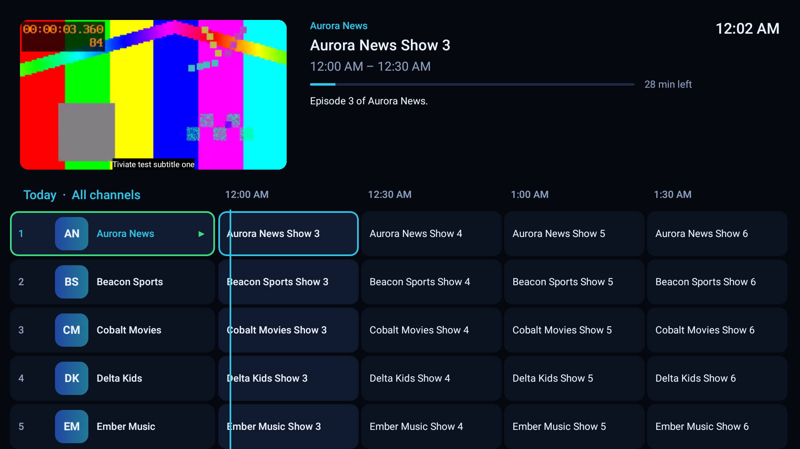<br><sub><b>TV guide</b> — live preview, minutes left, playing channel marked in green</sub></td>
    <td align="center">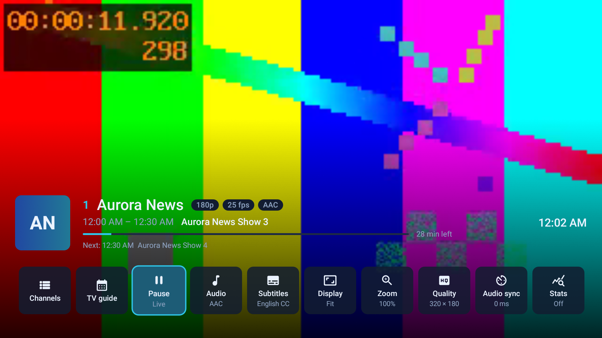<br><sub><b>Player options</b> (OK) — current value under every tile</sub></td>
  </tr>
  <tr>
    <td align="center">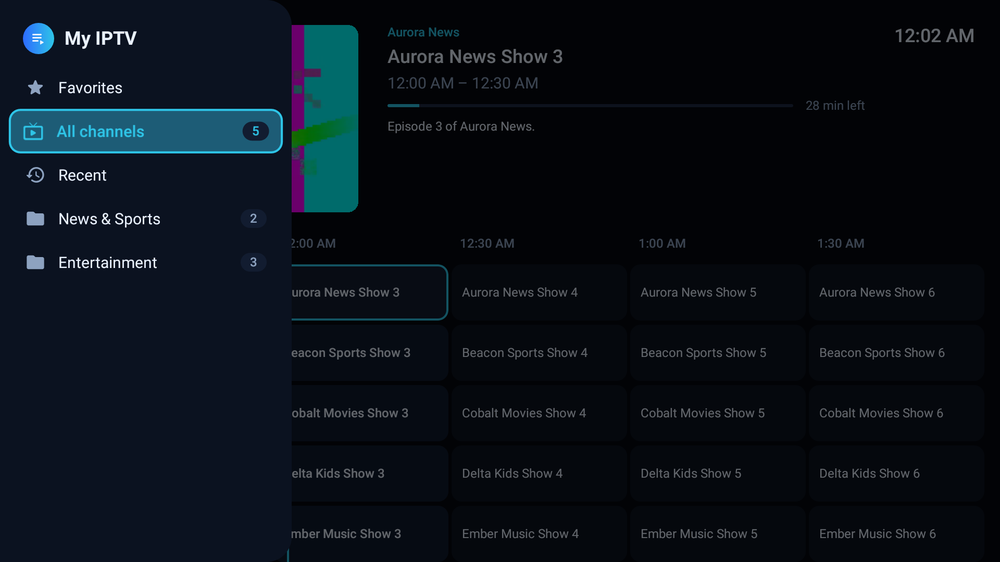<br><sub><b>Groups</b> (Left) — icons and channel counts</sub></td>
    <td align="center">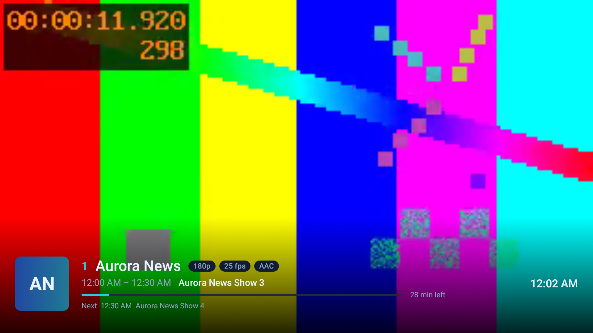<br><sub><b>Info bar</b> — now/next, progress, stream badges</sub></td>
  </tr>
  <tr>
    <td align="center">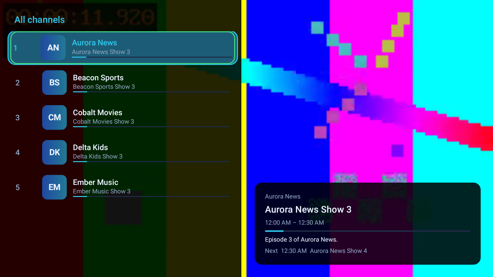<br><sub><b>Channel list</b> with what's on now</sub></td>
    <td align="center">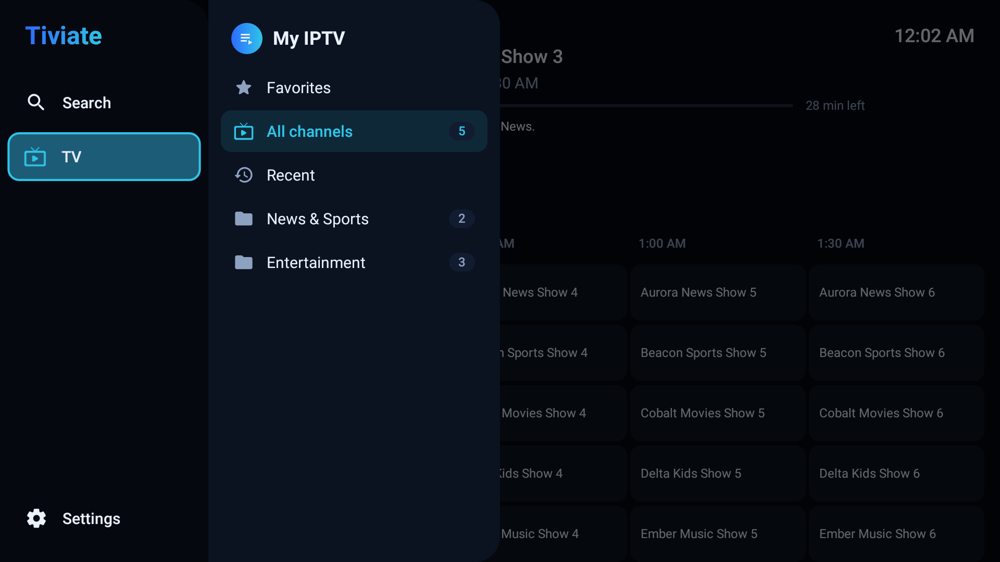<br><sub><b>Side menu</b> (Left again) — Search, TV, Settings</sub></td>
  </tr>
  <tr>
    <td align="center">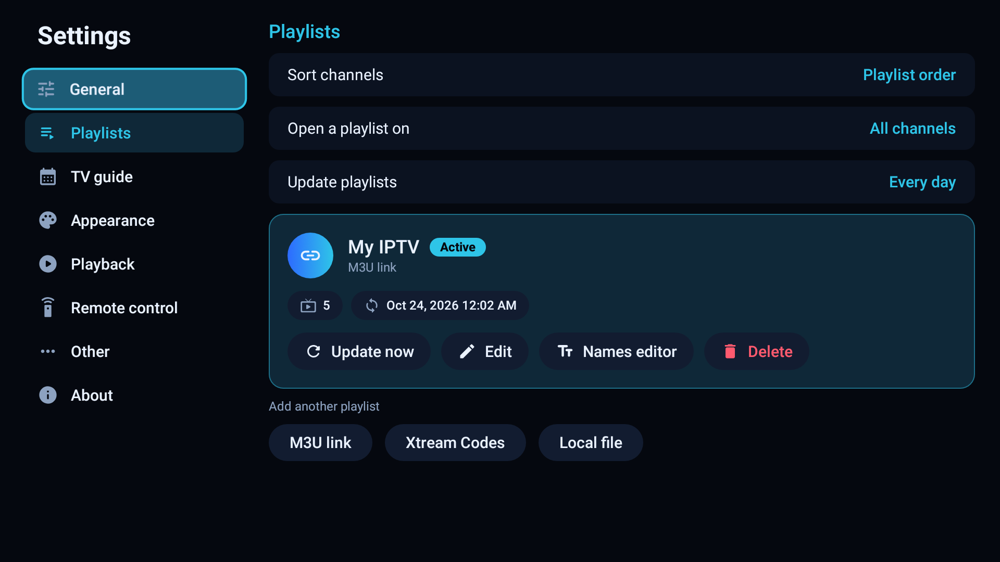<br><sub><b>Playlists</b> — account status, expiry, connections</sub></td>
    <td align="center">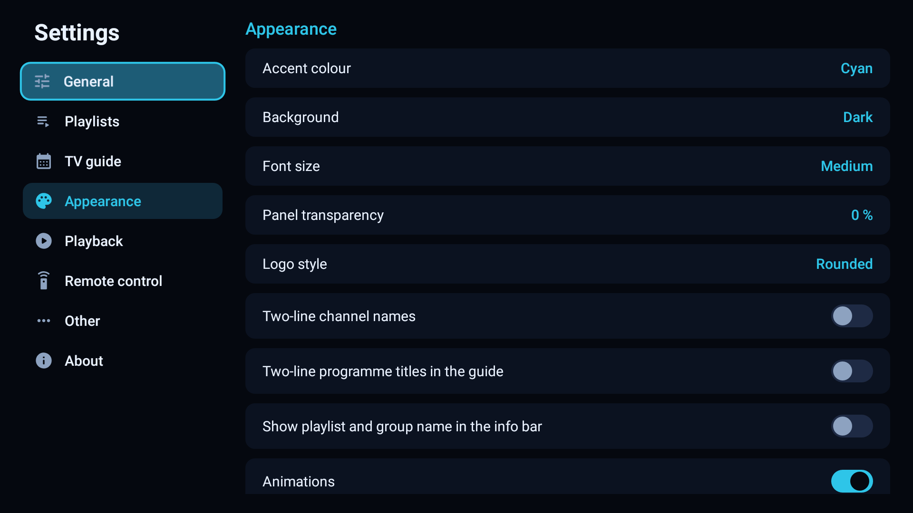<br><sub><b>Appearance</b> — colours, fonts, clock, screens</sub></td>
  </tr>
  <tr>
    <td align="center">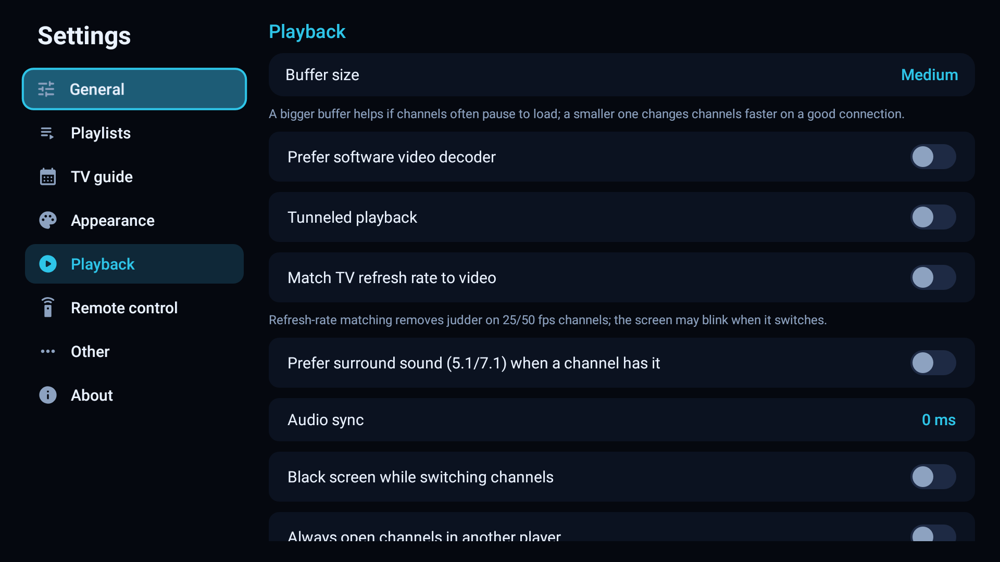<br><sub><b>Playback</b> — buffer, decoders, subtitles, surround</sub></td>
    <td align="center">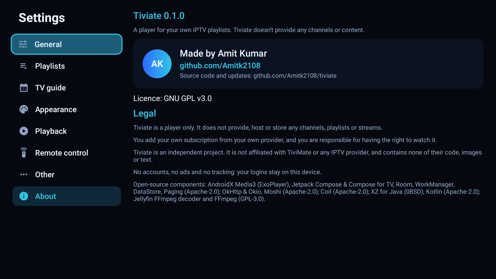<br><sub><b>About</b> — who made it, licence and legal notice</sub></td>
  </tr>
  <tr>
    <td align="center">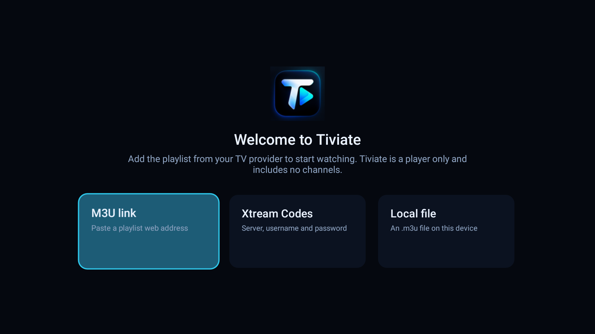<br><sub><b>First start</b> — add your playlist</sub></td>
    <td align="center">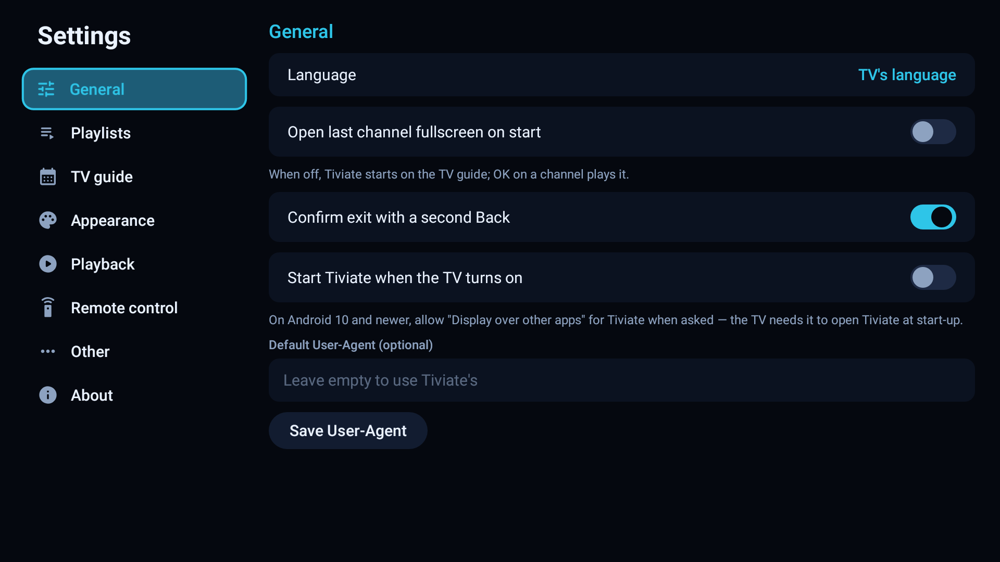<br><sub><b>General settings</b></sub></td>
  </tr>
</table>

---

## 📥 Download

Get the latest signed APK from the **[Releases page](https://github.com/Amitk2108/tiviate/releases)**
(`Tiviate-<version>.apk`). One APK runs on Fire TV (Fire OS 7 and 8), Android TV / Google TV boxes and
TVs, and Android phones and tablets (touch works too).

### Install on a Fire TV or Android TV

**With the Downloader app (no computer):**
1. On the TV: *Settings → My Fire TV → Developer options* → turn on **Apps from unknown sources** (for
   Downloader). If Developer options is missing: *Settings → My Fire TV → About* → press OK on the device
   name 7 times.
2. Install **Downloader** from the Amazon Appstore, open it and enter the APK link from the Releases page.
3. Install, then open **Tiviate** from your apps.

**With a computer (adb):**
1. On the TV, also turn on **ADB debugging**, and note the IP address (*Settings → My Fire TV → About → Network*).
2. On the computer:
   ```bash
   adb connect <TV-IP>:5555
   adb install -r Tiviate-0.1.0.apk
   ```
   Accept the "Allow USB debugging?" prompt on the TV the first time.

### First start

Pick how your provider gave you the playlist — **M3U link**, **Xtream Codes** (server, username,
password) or a **local `.m3u` file** — and Tiviate loads the channels, groups and TV guide by itself.
Your login is saved on the TV only and can be edited or removed in *Settings → Playlists*.

---

## ✨ Features

Every feature is free. There is no premium version, no account, no activation and no ads.

### 📺 Playback
- Media3 (ExoPlayer) engine with **hardware decoding** and automatic software fallback
- **AC3 / E-AC3 / DTS** sound on TVs that can't decode it, through the bundled FFmpeg audio decoder
- **Fast channel start**; the last picture stays on screen while the next channel loads (or a black screen, if you prefer)
- **One video surface for the whole app** — no black flash between fullscreen and the guide; the picture glides between the two
- **Auto-reconnect** with backoff, a frozen-stream watchdog and clear error messages (channel down at the provider, account busy elsewhere, access denied, no connection, unsupported format) with *Try again / Next channel / Other player*
- **Buffer size** (small → very large), software video decoder, tunnelled playback, refresh-rate matching
- **Pause live TV**, then *Back to live*
- **Audio tracks**, "use this language for all channels", **surround** preference
- **Subtitles**: per channel or for all channels, follow the TV's caption style; **English channels get subtitles by default**, Hindi and other channels don't (switchable)
- **Audio sync** (−500 to +500 ms), per channel or for all
- **Display mode** (Fit, Stretch, Fill, 16:9, 4:3) and **zoom**, per channel or for all
- **Video quality** (automatic or a fixed resolution), **stats** overlay (codec, bitrate, buffer, dropped frames)
- **Sleep timer**, **picture-in-picture** (option card, or on the Home button), always-open-in-another-player

### 🧭 Browsing
- **TV guide** with a live preview, the programme on now, **minutes left**, descriptions and images; the playing channel has a **green "live" border**
- The guide **keeps up with the clock** and returns to *now*; past days kept (1–7) and the future as far as your provider publishes; **fetched again automatically** when it is about to run out
- **Groups column** (Left) with icons and channel counts, **side menu** (Left again)
- **Channel list** with what's on now, optional preview window, autoplay while browsing, "stay on the list"
- **Guide over the video** (overlay mode) as an option
- **Favorites**, **Recent** channels (count and delay adjustable), **your own groups**
- **Search** over channels and the programmes on now
- **Previous channel** key and option card; **peek** at the next/previous channel's programme from the info bar (Info, then Left/Right)
- Opens on the **last group** you used (Favorites, Recent, your own groups included); **no autoplay** on start — OK plays

### 🗂️ Organising
- **Long-press OK** on any channel: hide, rename / restore name, add to favorites, add to your groups, **assign the guide by hand**, see the programme description
- **Manage visibility**, **reorder** channels and groups, hide or rename groups
- **Names editor**: strip prefixes and suffixes like `UK:` or `| FHD` from channel names
- **Sort**: playlist order, name, number, newest, most watched or your own order
- **Option cards**: choose which player options show and in what order

### 📥 Playlists and guide
- **M3U / M3U8 links**, **Xtream Codes** (account status, expiry with days left, connections), **local `.m3u` files** with a built-in file browser
- Several playlists; switch between them from the groups column
- **Update playlists** when Tiviate starts, every day, week or month; the guide every 6/12/24 hours
- **XMLTV guides**: found automatically from the playlist, plus your own links (plain, `.gz`, `.xz`); rename and remove sources
- Channel matching by `tvg-id`, then by name
- **Logos**: playlist logo → guide icon → letter tile; saved on the device, remembered links, pre-loaded, crisp on 4K screens
- Per-playlist and default **User-Agent**

### 🎨 Look and feel
- Modern TV design: accent glow focus, rounded panels, icons, pill switches, info chips
- **12 accent colours**, 3 backgrounds, **font size**, panel transparency, logo style, two-line names and titles
- Clock size, date and position, clock over the video; show or hide *All channels*, *Favorites* and *Recent*
- Animations on/off (everything stays light on low-memory TV boxes)
- **40 languages**, following the TV's language or chosen in Settings

### ⚙️ System
- Start Tiviate when the TV turns on, open the last channel fullscreen on start, confirm exit
- **Hold Back** on any screen to return to the player
- **Updates inside the app**: Tiviate checks this project's GitHub Releases once a day (or when you choose
  *Check for updates*), shows what's new, downloads the APK and opens the installer; *Later* skips that
  version, and the check can be turned off
- **Backup and restore**: playlists (with their logins), favorites, recent channels, your own groups, hidden /
  renamed / reordered channels, guide links and all settings in one file in `Download/Tiviate`; restore from
  the list or pick any backup file, for example after reinstalling
- **Automatic stream fallback**: when a channel fails as `.ts`, Tiviate tries the `.m3u8` link (or the other
  way round) and remembers the one that worked
- **Quick start-up**: a baseline profile ships with the app, so it opens fast from the first launch
- No accounts, no ads, no analytics, no tracking — nothing leaves your TV except the requests to your own
  provider and the update check

---

## 🎮 Remote control

Everything works with a basic Fire TV remote.

| Key | Fullscreen | Channel list | TV guide |
|---|---|---|---|
| **OK** | Player options (Channels, TV guide, Pause, Audio, Subtitles, Display, Zoom, Quality, Audio sync, Stats, Sleep…) | Play the channel | Play in the preview; OK again → fullscreen |
| **Hold OK** | Player options | Channel menu (hide, rename, favorite, groups, guide) | Channel and programme menu |
| **Up / CH+** | Next channel | Move | Move (CH± pages) |
| **Down** | Player options (or previous channel, if you choose "Up and Down: change channel") | Move | Move |
| **CH−** | Previous channel in the list | — | Page |
| **Left** | Channel list with groups | Groups | Earlier programme; on *now* → groups, again → menu |
| **Right / Guide** | TV guide | — | Later programme |
| **Info** | Info bar; then Left/Right peek at other channels, OK switches | — | — |
| **Menu** | Player options | — | Channel and programme menu |
| **Last channel** | Previous channel | | |
| **Play / Pause** | Pause / resume | | |
| **FF / RW** | | | Jump ±2 hours |
| **0–9** | Go to a channel number | | |
| **Back** | TV guide | Close | Press twice to exit |
| **Hold Back** | Back to the player from any screen | | |

---

## 🛠️ Building from source

Requirements: **JDK 17** and the **Android SDK** (compileSdk 36). Android Studio works too.

```bash
git clone https://github.com/Amitk2108/tiviate.git
cd tiviate
./gradlew :core:test :app:testDebugUnitTest   # unit tests (JVM)
./gradlew :app:connectedDebugAndroidTest      # UI tests on an Android TV emulator or device
./gradlew :app:assembleDebug                  # debug APK
./gradlew :app:assembleRelease                # signed release APK (needs keystore.properties)
```

- **Release signing:** `keystore.properties` (git-ignored) with `storeFile`, `storePassword`, `keyAlias`,
  `keyPassword`. Every update must be signed with the same key, or TVs refuse to install it over the old one.
- **Release build** is minified with R8 (`app/proguard-rules.pro`); classes loaded by name, like the FFmpeg
  renderer, have keep rules.
- **README screenshots:** `./gradlew :app:connectedDebugAndroidTest -Pandroid.testInstrumentationRunnerArguments.class=app.tiviate.ReadmeScreenshots -Pandroid.testInstrumentationRunnerArguments.screenshots=true`, then `adb pull /sdcard/tiviate-shots/ docs/screenshots/`.
- **Optional real-provider check:** `local.test.properties` (git-ignored) with `xtream.server`,
  `xtream.username`, `xtream.password` enables `RealProviderSyncTest`. Never commit it.

### Making a release

1. Bump `versionCode` and `versionName` in `app/build.gradle.kts` and add a section to [CHANGELOG.md](CHANGELOG.md).
2. Run the unit and emulator tests, then `./gradlew :app:assembleRelease`.
3. Rename `app/build/outputs/apk/release/app-release.apk` to `Tiviate-<version>.apk`.
4. Create a GitHub Release tagged `v<version>` and attach the APK
   (`gh release create v<version> Tiviate-<version>.apk --notes-file <notes>`).

### Project layout

| Path | What's inside |
|---|---|
| `core/` | Pure Kotlin: streaming M3U, XMLTV and Xtream parsers, guide matching, names editor, stable channel keys |
| `app/src/main/java/app/tiviate/data/` | Room database (with migrations), sync (WorkManager), settings (DataStore), repositories |
| `app/src/main/java/app/tiviate/player/` | Media3 engine, reconnects, sleep timer, controller |
| `app/src/main/java/app/tiviate/ui/` | Compose for TV screens: guide, player, channel list, settings, organising, onboarding |
| `app/src/main/assets/i18n/` | Translations (one JSON file per language, keyed by the English text) |
| `docs/` | Design spec, implementation plans and screenshots |

### Tech stack

Kotlin · Jetpack Compose & Compose for TV · AndroidX Media3 (ExoPlayer) · Jellyfin FFmpeg decoder · Room ·
WorkManager · DataStore · Paging · OkHttp · Moshi · Coil · XZ for Java.

---

## 🤝 Contributing

Bug reports, ideas, translations and pull requests are welcome — see **[CONTRIBUTING.md](CONTRIBUTING.md)**.

## ⚖️ Legal

- **Player only.** Tiviate is media-player software. It does not provide, sell, host, store, index or link
  to any channels, playlists, streams, subscriptions or other content, and has no servers of its own.
- **Your own subscription.** You add a playlist or login that you obtained yourself from your own provider.
  The channels, guide data and logos you see come directly from that provider. You are responsible for
  having the rights to the content you watch and for following the laws that apply where you live.
  The project does not support or endorse access to unauthorised streams.
- **Independent work.** Tiviate is an independent open-source project. It is **not affiliated with,
  endorsed by or connected to TiviMate, AR Mobile Dev, or any IPTV provider or broadcaster.** It contains
  **no code, images, text, icons, colours or other assets** from TiviMate or any other proprietary player;
  its code, design and texts were written for this project. Features common to TV players (a guide, a
  channel list, favorites…) are general ideas, not anyone's property.
- **Trademarks.** TiviMate, Fire TV, Android TV and other names are trademarks of their respective owners
  and are used here only to describe compatibility or comparison.
- **Privacy.** No accounts, no analytics, no ads, no tracking. Your playlist logins are stored only on your
  device, and the only network requests go to the addresses you entered (your provider, guide links and
  logo hosts) and, unless you turn it off, a daily update check with GitHub (`api.github.com`) that sends
  nothing about you. Backup files contain your playlist logins: keep them private.
- **No warranty.** Tiviate is provided "as is", without warranty of any kind (see sections 15–16 of the GPL).
- **Takedown or rights questions:** please open an issue on this repository.

## 📄 Licence

Copyright © 2026 **Amit Kumar** ([@Amitk2108](https://github.com/Amitk2108)).

Tiviate is free software under the **GNU General Public License v3.0** — see [LICENSE](LICENSE). Third-party
components and their licences are listed in [NOTICE](NOTICE). (Tiviate is GPL-3.0 because it ships the FFmpeg
audio decoder for AC3/E-AC3/DTS channels.)
